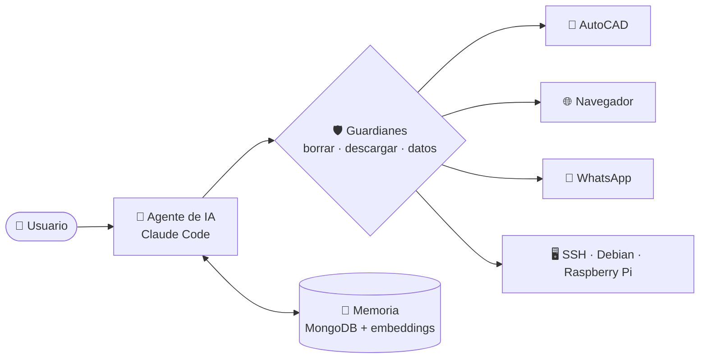

<!-- Perfil de GitHub: este archivo va en el repo Kuraga92/Kuraga92 -->


<p align="center">
  <a href="https://github.com/Kuraga92">
    
  </a>
</p>

<p align="center">
  
  
  
  
  
</p>

---

### 🧑‍💻 Sobre mí

```yaml
nombre:      Ramiro Gastón Kuspita
rol:         Desarrollador Full Stack · IA aplicada · Soporte de aplicaciones
formación:   Técnico Informático · Técnico Electromecánico · Ing. Electrónica (UNaM, cursada)
desde_2023:  software a medida para clientes + agentes de IA que operan programas reales
aprendiendo: ingeniería de LLM, agentes y skills · Microsoft Power Platform y Azure
me_gusta:    entender por qué falla algo y convertir cada falla en una mejora
```

### 🛠️ Stack

<p align="center">
  
  <br/>
  
</p>

### 🚀 En qué trabajo

<table>
  <tr>
    <td width="50%" valign="top">
      <h4>📐 MCP para AutoCAD</h4>
      Servidor MCP en Python (COM) que permite que un agente de IA dibuje en AutoCAD 2023 en tiempo real: planos 2D/3D y
      <b>diseño de tableros eléctricos</b> (cálculo, validación, listas y planos A4).
      <br/><br/>
      
      
      
    </td>
    <td width="50%" valign="top">
      <h4>🏔️ InfoChaltén</h4>
      App de guía turística y servicios de El Chaltén, hecha para un cliente: Flutter + Firebase, con reglas de
      seguridad probadas y despliegues.
      <br/><br/>
      
      
      
    </td>
  </tr>
  <tr>
    <td width="50%" valign="top">
      <h4>🧠 Memoria para agentes</h4>
      Memoria persistente entre sesiones en MongoDB con búsqueda por embeddings: los agentes recuerdan decisiones,
      lecciones y el estado de cada proyecto.
      <br/><br/>
      
      
      
    </td>
    <td width="50%" valign="top">
      <h4>☁️ DiskOnline</h4>
      Nube personal sobre un servidor propio: backend FastAPI y app Android, con acceso remoto por Tailscale y 2FA.
      <br/><br/>
      
      
      
    </td>
  </tr>
  <tr>
    <td width="50%" valign="top">
      <h4>🔌 Servidores MCP propios</h4>
      Agentes que operan el navegador, WhatsApp, YouTube, SSH y VirusTotal, con guardianes que piden permiso antes de
      borrar, descargar o mandar datos personales.
    </td>
    <td width="50%" valign="top">
      <h4>📍 Control de personal</h4>
      App de asistencia con GPS, huella y QR (Flutter + Firebase). Además: runner propio de GitHub Actions en Docker
      para builds de Node, Rust y Tauri.
    </td>
  </tr>
</table>

### 🗺️ Cómo encajan mis agentes



### 📊 Actividad

<p align="center">
  
</p>

<p align="center">
  <picture>
    <source media="(prefers-color-scheme: dark)" srcset="https://raw.githubusercontent.com/Kuraga92/Kuraga92/output/github-snake-dark.svg"/>
    <source media="(prefers-color-scheme: light)" srcset="https://raw.githubusercontent.com/Kuraga92/Kuraga92/output/github-snake.svg"/>
    
  </picture>
</p>

### 🎓 Formación

- **Técnico Informático** · Instituto Borges
- **Cursos UTN FRBA (2023):** Desarrollo Web MERN · Front End · Java Full Stack · QA Testing Manual
- **Silicon Misiones:** Programación desde Cero · Ciberseguridad
- **En curso:** ingeniería y diseño de LLM, agentes y skills de IA (mentoría con un ingeniero)


